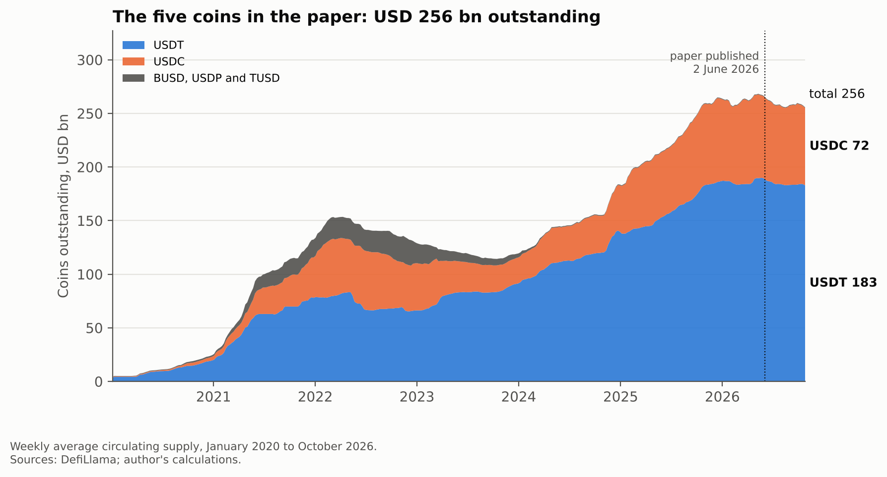
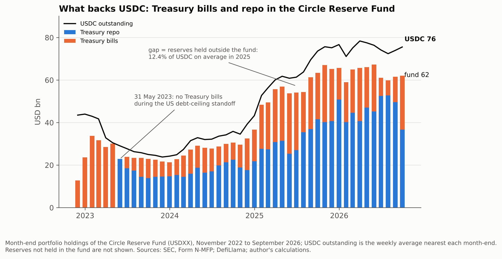
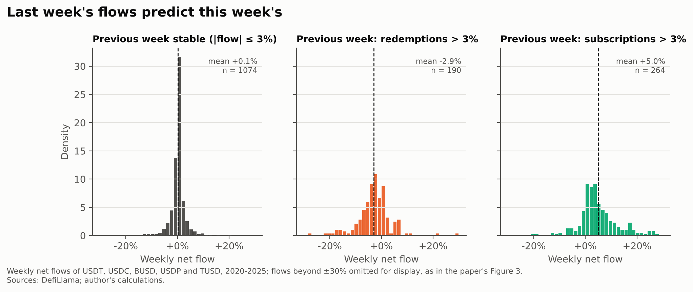
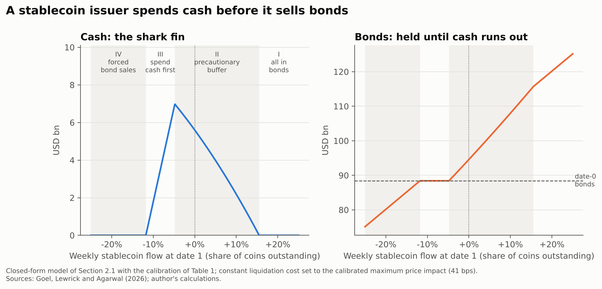
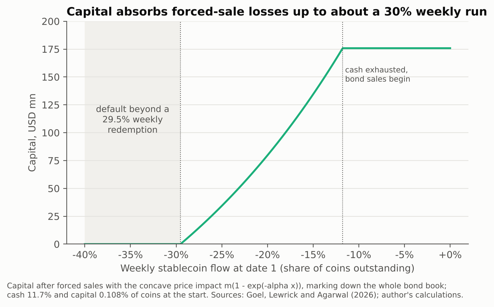
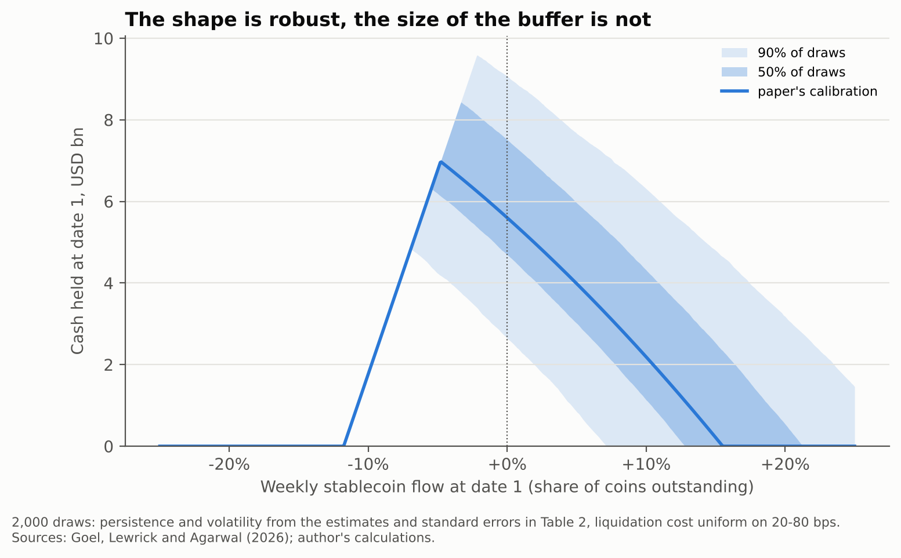
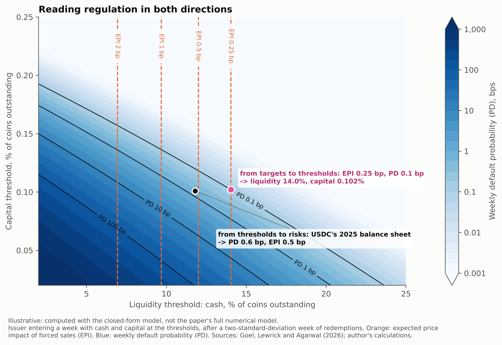

# Charting BIS Working Paper 1355

A worked example of how I would produce the figures for a BIS publication, using Goel, Lewrick and
Agarwal (2026),
[*Making stablecoins stable(r): can regulation help?*](https://www.bis.org/publications/working-paper-1355-making-stablecoins-stabler-can-regulation-help),
BIS Working Paper No 1355.

The paper models a stablecoin issuer whose coins are redeemable on demand and backed by cash, which
earns nothing, and short-term government bonds, which earn interest but are costly to sell in a
hurry. Persistent redemptions can exhaust the cash and force bond sales, and liquidity and capital
thresholds can contain the resulting default risk and market spillovers. The seven figures below start
from the data, how large the issuers are, what their reserves are made of and how their flows
behave, and then carry the model's argument one step at a time. All of them come from one
reproducible Python pipeline.

## The workflow

| Step | In this repository |
|---|---|
| Understand the mechanism and the findings each figure must carry | one figure per step of the argument, listed below |
| Identify the quantities required | the closed-form model of the paper's Section 2.1 in `src/model.py`, the calibration of its Table 1, weekly stablecoin supply from DefiLlama, the monthly portfolio holdings of USDC's reserve fund from its SEC filings |
| Verify the calculations behind each figure | `src/validate.py` compares the numbers behind the figures with the paper |
| Design each figure around its analytical purpose | stacked areas for size and concentration, stacked bars against a line for reserves against coins, conditional distributions for persistence, one curve for the cash policy, bands for parameter sensitivity, contours for comparing regulatory scenarios |
| Keep data and model results apart | each figure's note gives its sources: the data provider for the empirical charts, the paper's model and calibration for the others |
| Automate and apply consistent conventions | `python run_all.py` rebuilds everything; `src/style.py` sets one palette, type and layout for all figures |
| Export publication-ready figures | each figure is saved as PNG and as vector SVG in `figures/` |

## The figures

### 1. How large the issuers have become



Weekly circulating supply of the five coins the paper studies, from January 2020. Stacking the coins
shows both the total and how much of it two issuers, Tether and Circle, account for. The publication date is marked so that later charts can be read against
it.

### 2. What backs USDC



The paper's issuer chooses between cash and short-term government bonds. For USDC this choice can be
seen directly: most of its reserves sit in the Circle Reserve Fund, a money market fund whose
holdings are filed monthly with the SEC on Form N-MFP. The bars show the fund's Treasury bills and
Treasury repo at each month-end since November 2022, and the line shows USDC outstanding, so the gap
is the part of the reserves held outside the fund. On 31 May 2023, during the US debt-ceiling
standoff, the fund held no Treasury bills at all.

### 3. Last week's flows predict this week's



Persistence is the reason an issuer holds a precautionary buffer at all. Showing the distribution of
weekly flows after stable weeks, after redemptions and after subscriptions makes it visible without
a regression coefficient: the whole distribution shifts with the previous week. Shared axes and bins
keep the comparison about position rather than shape, as in the paper's Figure 3.

### 4. The shark fin



The issuer's cash policy from the paper's first-order condition,
$`\mathbb{P}_1(r_2 < -c_1/s_1) = \mu/\kappa`$, which gives $`c_1^* = s_0(1+r_1)(\sigma z^* - \gamma r_1)`$.
A single curve carries the four phases: no cash after large inflows, a precautionary buffer, cash
spent first when redemptions arrive, and bond sales once cash runs out. The phases are shaded and
named in words, and the bond panel shows the same flows from the other side of the balance sheet.

### 5. Forced sales and capital



Where private liquidity management turns into market-wide price impact. Beyond the point where cash
runs out, bond sales with the paper's concave price impact, $`m(1 - e^{-\alpha x})`$, erode capital
until the issuer defaults. Both thresholds are marked and named on the chart.

### 6. The cash policy across parameter uncertainty



The shark fin redrawn across 2,000 draws of persistence and volatility from the paper's estimates and
standard errors, and of the liquidation cost across 20–80 bps. Bands rather than a single line show
which features of a figure hold across the plausible range of the parameters and which depend on a
particular calibration.

### 7. Reading regulation in both directions



Contours of equal default probability and equal expected price impact over pairs of liquidity and
capital thresholds, so that a regulator can read the map from thresholds to the risks they imply or
from chosen targets to the thresholds that achieve them, the two-way mapping at the centre of the
paper. This version is computed from the closed-form model rather than the paper's full numerical
model, which the chart states underneath; the plotting code would take the authors' model output
directly in its place.

## Validation

`src/validate.py` writes [`figures/validation.csv`](figures/validation.csv):

| Check | This repository | Reference |
|---|---|---|
| Flow persistence, all five coins | 0.417 (95% CI 0.16 to 0.67) | 0.361, paper Table 2 |
| Flow volatility, all five coins | 5.9% | 6.3%, paper Table 2 |
| Flow persistence, USDT and USDC | 0.518 (95% CI 0.27 to 0.77) | 0.462, paper Table 2 |
| Flow volatility, USDT and USDC | 2.6% | 2.8%, paper Table 2 |
| USDC reserves held outside the fund, 2025 average | 12.4% | 11.8% cash ratio for USDC, paper Annex D |
| Cash policy formula against a numerical solution of the issuer's problem | largest gap USD 0.01 bn | 0 |

The flow estimates use DefiLlama circulating supply rather than the paper's CoinGecko data, which
explains the small differences. The share of USDC held outside the fund, computed from SEC filings
and DefiLlama, comes close to the cash ratio the paper uses for USDC, which ties the model's
calibration to the reserve data in figure 2.

## Running it

```bash
pip install -r requirements.txt
python src/fetch_flows.py     # weekly stablecoin supply (DefiLlama) into data/
python src/fetch_reserves.py  # monthly Circle Reserve Fund holdings (SEC, Form N-MFP) into data/
python run_all.py             # all figures and the validation table
```

Only the two fetch scripts need a network connection; the data they download is already in `data/`, so
`run_all.py` runs offline.

## Credit

The model, its calibration and the findings are from Goel, Lewrick and Agarwal (2026). The code and
figures are mine, and any errors are mine.

Karmen Zupančič
